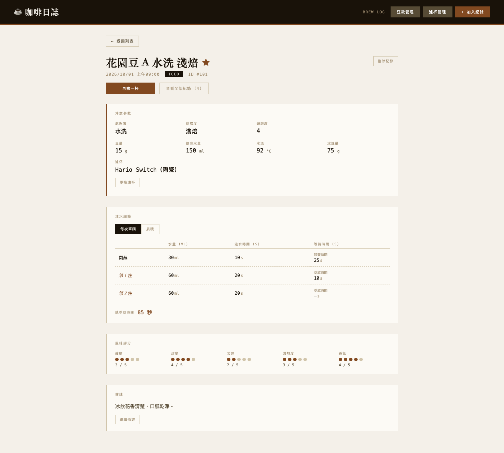

# Brewfolio ☕

Brewfolio 是一個手沖咖啡日誌，讓你記下每一杯的配方、注水過程與品飲心得，回頭找出想重現的沖法。

## 功能亮點

- **記下能重現的配方** — 記錄冰熱、粉量、研磨刻度、水溫、水量與冰量。分段記錄注水量、注水與等待時間，詳情可切換單段與累計。
- **從上一杯開始調整** — 「再煮一杯」帶入原本的配方、濾杯與注水設定。可先修改參數，再存成一筆保留來源的新紀錄。
- **找出喜歡的沖法** — 記下酸、甜、苦、醇厚度與香氣評分，搭配備註與星標。可依豆款、烘焙度、冰熱或備註篩選，從詳情直接查看同豆款的全部紀錄。
- **管理豆款與濾杯** — 豆款可以標記用完並保留歷史紀錄。濾杯可登錄名稱與材質，新增沖煮時選用，也能回頭補記。
- **用 AI 助理查詢沖煮資料** — 透過三個唯讀 MCP 工具搜尋沖煮紀錄、取得完整配方，以及比較兩杯的參數和評分差異。

## 頁面預覽

以下畫面使用虛構的沖煮資料。

### 咖啡日誌


### 沖煮詳情



### 濾杯管理


## 用到的東西

- 前端：HTML、CSS、原生 JavaScript。
- 後端：Node.js、Express。
- 資料庫：MySQL，搭配 .NET 8 寫的 migration 工具。

```text
frontend/                  # 咖啡日誌介面
backend/                   # API
database/CoffeeMigrator/   # 資料庫 migration
database/migrate.js        # migration 執行入口
mcp/                       # 三個唯讀 MCP 工具：stdio / HTTP
scripts/mcp-check.js       # 真正 MCP client 的展示與連線檢查
docs/                      # 資料字典、驗收案例與 MCP Demo
tests/                     # 自動測試
openapi.yaml               # Swagger / OpenAPI API 規格
.env.example               # 連線設定範例
```

## 資料定義與資料庫更新

欄位單位、感官分數、星標、豆款主檔／快照與 AI 解讀規則見 [資料字典](docs/data-dictionary.md)。 AI 助理的測試情境與預期結果見 [驗收 Prompt 草稿](docs/agent-acceptance-prompts.md)。研磨度保留個人刻度；冰塊量以 g 記錄，MCP 介面名稱為 `ice_weight_g`，現有 HTTP API 仍使用 `ice_vol`。

需要 Node.js 22.9 以上、MySQL 與 .NET 8 SDK。首次啟動時，先在 MySQL 建立資料庫，再將 `.env.example` 複製為 `.env`，填入連線設定與資料庫名稱。

```sh
npm ci
npm run db:migrate
npm start
```

啟動後開啟 <http://localhost:3001>。更新既有安裝時也請先執行 migration。V003 新增豆款的用完標記，V004 新增濾杯清單和沖煮紀錄的濾杯關聯。

在「濾杯管理」登錄名稱和材質後，可以在新增沖煮時選擇濾杯。「再煮一杯」會帶入原濾杯，舊紀錄可在詳情補記或更換。濾杯欄位可留空，已被沖煮紀錄使用的濾杯會保留。

## MCP 面試 Demo

不需 MySQL 或模型金鑰，可先執行：

```sh
npm run mcp:check
```

這會透過真正的 MCP client 呼叫 `search_brews`、`get_brew`、`compare_brews`，使用明確標記的虛構資料，不會更動你的日常紀錄。HTTP demo 使用 `npm run mcp:demo`，服務位址為 `http://127.0.0.1:3002/mcp`。

[完整 Demo、Inspector、MySQL 與 ChatGPT 連接步驟](docs/mcp-demo.md)。

## API 文件

目前的 API 規格寫在 `openapi.yaml`，使用 OpenAPI 3.0.3 格式。之後如果要接 LINE bot、GPT API tool calling，或用 Swagger UI 查看 endpoint，都可以從這份規格開始。

本機開發 API 預設跑在：

```text
http://localhost:3001
```

## 目前 endpoints

| Method | Path | 功能 |
| --- | --- | --- |
| GET | `/api/brews` | 取得沖煮紀錄列表，依時間由新到舊排序，包含豆款顯示名稱、冰熱、星標與備註。 |
| GET | `/api/brews/:id` | 取得單筆沖煮紀錄，包含豆款資料、沖煮參數、評分、備註、來源紀錄與分段注水。 |
| GET | `/api/beans` | 取得所有豆款，依豆款名稱排序。 |
| POST | `/api/brews` | 新增沖煮紀錄與分段注水，並快照當下豆款資訊。 |
| PATCH | `/api/brews/:id/notes` | 更新單筆沖煮紀錄的備註。 |
| PATCH | `/api/brews/:id/starred` | 更新單筆沖煮紀錄的星標狀態。 |
| PATCH | `/api/brews/:id/dripper` | 補記、更換或清除沖煮紀錄的濾杯。 |
| DELETE | `/api/brews/:id` | 刪除單筆沖煮紀錄與其分段注水。 |
| POST | `/api/beans` | 新增豆款。 |
| PUT | `/api/beans/:id` | 編輯豆款名稱、處理法與烘焙度。 |
| PATCH | `/api/beans/:id/finished` | 更新用完狀態，接受 `{ "is_finished": true/false }`。 |
| DELETE | `/api/beans/:id` | 刪除未被沖煮使用的豆款；有歷史紀錄時回傳 409。 |
| GET / POST | `/api/drippers` | 列出或新增濾杯。 |
| PUT / DELETE | `/api/drippers/:id` | 更新或刪除濾杯；有歷史紀錄時刪除會回傳 409。 |

目前 `openapi.yaml` 包含查詢、沖煮新增、豆款用完狀態更新與濾杯相關操作。新增沖煮會驗證型別、範圍與關聯。注水合計不同時仍會儲存，並回傳 `warnings` 提醒。

## 還在想的事

摩卡壺的紀錄方式先多煮幾杯再想，累積一點實際經驗，看看哪些資料真的值得留下來。

之後也想試試 GPT API 搭配 LINE 或其他 bot，根據過去的沖煮紀錄討論下一杯可以怎麼調整。
