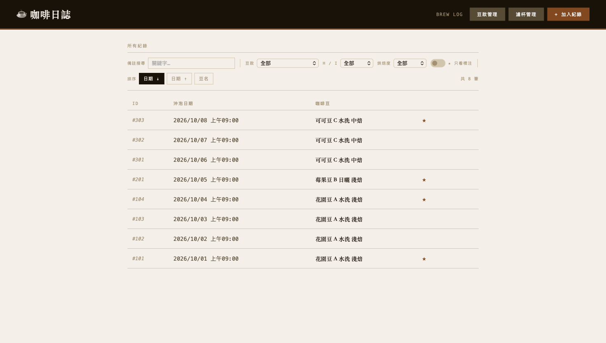
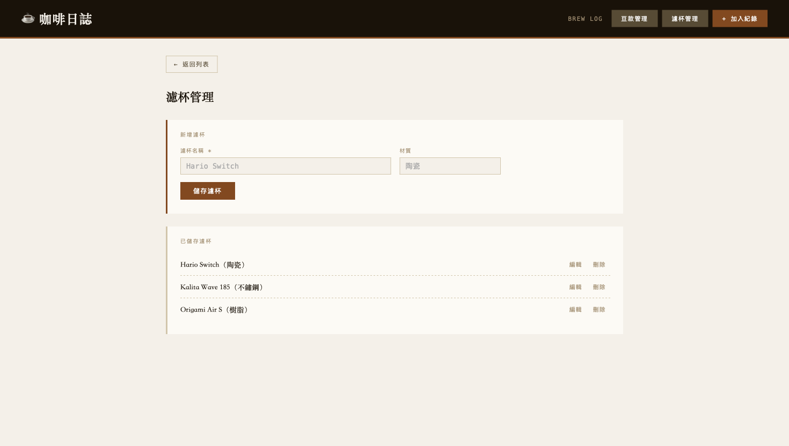

# Brewfolio ☕

Brewfolio 是可在自己電腦上執行的手沖咖啡日誌。記下每杯的配方、注水過程和風味，找回喜歡的沖法，再從上一杯的參數開始調整。

[快速開始](#快速開始) · [使用方式](#使用方式)

## 功能亮點

- **記下每杯的配方**。保存粉量、研磨刻度、水量、水溫、冰量與濾杯，分段記錄注水量、注水與等待時間。詳情可切換單段和累計檢視。
- **用上一杯的配方再煮一杯**。帶入原本的濾杯、沖煮參數和分段注水。調整後另存新紀錄，保留來源，方便回頭比較。
- **找回喜歡的沖法**。記下酸、甜、苦、濃郁度與香氣，為喜歡的沖煮加星標。可依備註、豆款、冰熱、烘焙度與星標篩選，也能從詳情直接查看同豆款的全部紀錄。
- **管理咖啡豆與濾杯**。標記已用完的豆款並保留歷史紀錄。登錄濾杯的名稱和材質，新增沖煮時選用，也能回頭補記。

## 快速開始

需要 Git、Node.js 22.9 以上、MySQL 8 和 .NET 8 SDK。

1. 下載專案、安裝依賴並建立設定檔。

   ```sh
   git clone https://github.com/ntustsvgrandmaster/brewfolio.git
   cd brewfolio
   npm ci
   cp .env.example .env
   ```

2. 在 MySQL 用戶端建立資料庫。預設名稱是 `coffee`。

   ```sql
   CREATE DATABASE coffee CHARACTER SET utf8mb4;
   ```

   在 `.env` 填入主機、連接埠、帳號、密碼與資料庫名稱（`DB_HOST`、`DB_PORT`、`DB_USER`、`DB_PASSWORD`、`DB_NAME`）。帳號必須能在該資料庫查詢、寫入資料，以及建立和更新資料表。

3. 建立資料表後啟動應用程式。

   ```sh
   npm run db:migrate
   npm start
   ```

4. 在瀏覽器開啟 [http://localhost:3001](http://localhost:3001)。

更新既有安裝時，請先執行 `npm ci` 和 `npm run db:migrate`，再啟動新版。

## 使用方式

1. 從「豆款管理」新增第一款豆子。想記錄器具時，也可以在「濾杯管理」登錄常用濾杯。
2. 點「＋ 加入紀錄」，選擇豆款和冰熱，填入沖煮參數。可以使用表單內的計時器記下各段注水和等待時間，最後加入風味評分和備註。
3. 從列表開啟一杯，點「★」收藏，或點「再煮一杯」用原配方開始下一筆。

## 頁面預覽

以下畫面使用虛構的沖煮資料。

### 咖啡日誌



[開啟咖啡日誌預覽圖](./docs/screenshots/brew-journal.png)

### 沖煮詳情


[開啟沖煮詳情預覽圖](./docs/screenshots/brew-detail.png)

### 濾杯管理



[開啟濾杯管理預覽圖](./docs/screenshots/dripper-management.png)

## 開發文件

Brewfolio 使用原生 HTML、CSS、JavaScript，搭配 Node.js、Express 和 MySQL。資料表版本由 .NET 8 的 migration 工具管理。

- [OpenAPI 規格](./openapi.yaml)
- [資料字典](./docs/data-dictionary.md)
- 執行 `npm test` 可跑自動測試。
